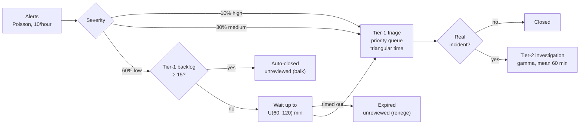

# SOC Alert Triage Simulation

**Discrete-event simulation of a two-tier Security Operations Center in R (`simmer`): how many analysts does it take to meet triage SLAs, and what does alert overload actually cost in missed incidents?**


-informational)


> **Origin:** built on discrete-event simulation methods from **ISQS 7339 Simulation & Optimization** at Texas Tech University (Spring 2022): queues with priorities, balking and reneging. The coursework modeled call centers and a clinic; this repository models alert triage.

---

## TL;DR

- **Question:** how many analysts a two-tier SOC needs to meet triage SLAs, and how many real incidents alert overload causes it to miss.
- **Analytic check (M/G/c queueing):** tier-2 is the bottleneck, with a 36-minute average wait for a confirmed incident. Only adding a tier-2 analyst fixes it; detection tuning and SOAR enrichment help tier-1 only.
- **Simulation (5 scenarios × 100 replications, 95% CIs):** confirms the bottleneck. One more tier-2 analyst cuts the wait for a confirmed incident from **33.9 to 4.4 minutes**; every other option leaves it near 34 minutes.
- **Stress test (10–22 alerts/hour):** the baseline team only just holds at 10 alerts/hour. One extra analyst in a single tier just moves the bottleneck: +1 tier-1 still breaks at 12/hour (tier-2 wait), and +1 tier-2 breaks at 14/hour (tier-1 drops alerts and misses 7.5 real incidents a week). **One more analyst in each tier holds to 18 alerts/hour.**
- **Priority queuing hides the damage:** fewer than 2% of high-severity alerts are ever triaged late, even at 22/hour. The cost of overload falls on low-severity alerts, up to 76% of which go unreviewed, and on the real incidents among them.
- **Improved on the coursework:** balking and reneging are now measured directly, rather than inferred from arrivals still in the system. Details: [CHANGELOG.md](CHANGELOG.md).


*Each line is a staffing option (tier-1 + tier-2 analysts); dashed lines are the service targets. Details in [Stress test](#stress-test).*

---

## Approach

### The question

A SOC receives a steady stream of alerts of mixed severity. Tier-1 analysts triage them; the real incidents go to tier-2 for investigation. When the backlog grows, low-severity alerts get auto-closed or age out unreviewed, and some of those were real. Leadership's options:

| Scenario | Change |
|---|---|
| Baseline | 2 tier-1, 2 tier-2 analysts, 10 alerts/hour |
| +1 tier-1 analyst | 3 tier-1 |
| +1 tier-2 analyst | 3 tier-2 |
| Detection tuning | 25% fewer alerts (false positives only, so real incidents/hour are unchanged) |
| SOAR enrichment | Low-severity triage twice as fast |

For each scenario: wait to triage by severity, SLA breach rates, share of low alerts auto-closed or expired, **real incidents missed per week**, tier-2 wait, and analyst utilization, each with a 95% confidence interval over 100 replications.

### The model



| Element | Modeling choice |
|---|---|
| Priorities | High > medium > low in both queues (non-preemptive) |
| Ground truth | Each alert's "real incident" flag is drawn on arrival but only revealed at triage, so the model can count real incidents that were auto-closed or expired: the cost of overload |
| Run length | 5 days per replication; day 1 discarded as warm-up; alerts from the last 4 hours excluded (outcome not yet known) |
| Seeds | Replication *i* uses the same seed in every scenario. This is not common random numbers: all draws share one random stream in event order, so the scenarios drift apart once staffing changes the order of events. Scenarios are compared on independent confidence intervals |
| Censoring | An alert still waiting at the end counts as an SLA breach only if it has already waited past the SLA |
| What can be missed | Only low-severity alerts are auto-closed or expire, so "real incidents missed" means real incidents among low-severity alerts (5% of them). High and medium alerts can only be late. Low alerts expire within 120 minutes, so their 240-minute SLA is never reached |
| Analysts | "2 + 2" means two analysts on duty in each tier at all times. Covering one seat 24/7 takes about 4.2 full-time staff (8,760 hours a year ÷ 2,080 paid hours, before leave and training), so the baseline is about 17 FTE and each extra seat about 4 more |

All parameters live in [`R/params.R`](R/params.R) and are **illustrative**. Every scenario is checked by `validate_params()` ([`R/validate.R`](R/validate.R)) before it runs.

## Results

### Analytic check (runs without simmer)

Before simulating, [`00_queueing_check.R`](scripts/00_queueing_check.R) treats each tier as an M/G/c queue (Erlang C with the Allen-Cunneen correction). It ignores priorities, auto-closing and expiry, so it's a ballpark and a stability check, not the answer:

| Scenario | Tier-1 utilization | Tier-1 mean wait (min) | Tier-2 utilization | Tier-2 mean wait (min) |
|---|---|---|---|---|
| Baseline | 69% | 4.7 | 70% | 36.0 |
| +1 tier-1 analyst | 46% | 0.6 | 70% | 36.0 |
| +1 tier-2 analyst | 69% | 4.7 | 47% | 4.7 |
| Detection tuning | 52% | 1.9 | 70% | 36.0 |
| SOAR enrichment | 54% | 2.0 | 70% | 36.0 |

Already a useful read: **tier-2 is the slower queue** (36 min average wait for a confirmed incident), and only adding a tier-2 analyst fixes it. Tuning and SOAR help tier-1 but leave tier-2 untouched, because they don't change the number of real incidents. The simulation adds what the formula can't: severity-specific SLA breaches, auto-closing and expiry under bursts, and missed incidents.

### Simulation

100 replications × 5 days per scenario, first day discarded as warm-up. Cells show the mean and 95% CI across replications; lower bounds that fall below zero are shown as 0.0. Full table and all three figures: [`docs/results.md`](docs/results.md).

| Metric | Baseline | +1 tier-1 | +1 tier-2 | Detection tuning | SOAR enrichment |
|---|---|---|---|---|---|
| Wait for tier-2 (min) | 33.9 (30.6–37.3) | 35.5 (32.1–38.8) | **4.4 (3.9–5.0)** | 34.8 (31.3–38.3) | 33.8 (30.1–37.5) |
| Wait to triage, high severity (min) | 1.8 (1.8–1.9) | **0.4 (0.4–0.5)** | 1.8 (1.7–1.8) | 1.1 (1.1–1.2) | 1.1 (1.0–1.1) |
| High alerts missing 15-min SLA | 0.1% (0.1–0.2) | 0.0% (0.0–0.0) | 0.1% (0.0–0.2) | 0.1% (0.0–0.2) | 0.1% (0.0–0.1) |
| Low alerts expired unreviewed | 0.2% (0.1–0.3) | 0.0% (0.0–0.0) | 0.2% (0.1–0.3) | 0.0% (0.0–0.0) | 0.1% (0.0–0.1) |
| Real incidents missed / week | 0.1 (0.0–0.3) | 0.0 (0.0–0.0) | 0.1 (0.0–0.2) | 0.0 (0.0–0.0) | 0.1 (0.0–0.1) |
| Tier-1 utilization | 69.4% | 46.4% | 69.3% | 51.5% | 53.4% |
| Tier-2 utilization | 69.8% | 69.9% | 46.5% | 68.9% | 69.2% |


- **Tier-2 is the bottleneck.** A confirmed incident waits about 34 minutes for an investigator unless tier-2 gets another analyst. Detection tuning and SOAR enrichment cut tier-1 load but don't change the number of real incidents, so they don't help here.
- **Tier-1 already meets its SLAs.** An extra tier-1 analyst cuts high-severity triage from 1.8 to 0.4 minutes, but high-severity SLA breaches are already only 0.1%.
- **The illustrative load is too light to show overload.** At baseline, 113 of 55,887 low-severity alerts (0.2%) were auto-closed or expired, and almost no medium or high alerts breached their SLA. The cost of alert overload only shows up at higher alert rates; see the stress test below.

### Stress test

The alert rate is swept from 10 to 22 per hour for four staffing options, with everything else at baseline values (30 replications × 5 days per point). An option "breaks" at the first rate where, on average, more than 5% of high-severity alerts are triaged late, more than 1 real incident a week is missed, or a confirmed incident waits more than 60 minutes for tier-2. All settings are in `STRESS` in [`R/params.R`](R/params.R).

| Analysts (tier-1 + tier-2) | Capacity, alerts/hour (tier-1 / tier-2) | Holds up to | Breaks at | Target missed there |
|---|---|---|---|---|
| 2 + 2 (baseline) | 14.4 / 14.3 | 10 | 12 | Tier-2 wait (70 min) and missed incidents (1.03/week), both borderline |
| 3 + 2 (+1 tier-1) | 21.6 / 14.3 | 10 | 12 | Tier-2 wait (100 min) |
| 2 + 3 (+1 tier-2) | 14.4 / 21.4 | 12 | 14 | Missed incidents (7.5/week) |
| 3 + 3 (+1 each) | 21.6 / 21.4 | **18** | 20 | Tier-2 wait (98 min) and missed incidents (4.1/week) |

"Capacity" is the alert rate at which a tier would be 100% busy if no alert were dropped: 7.2 alerts/hour per tier-1 analyst (8.3 minutes of triage per alert on average) and 7.1 per tier-2 analyst (14% of alerts are real incidents, 60 minutes each). The figure is at the top of this page.

- **Fixing one tier exposes the other.** An extra tier-1 analyst buys nothing on its own: tier-2 still breaks at 12 alerts/hour. An extra tier-2 analyst buys one step, to 12/hour; then tier-1 starts auto-closing low-severity alerts and real incidents go with them.
- **A faster tier-1 makes tier-2 worse.** At 12 alerts/hour a confirmed incident waits 100 minutes for tier-2 with 3 + 2 analysts, against 70 with 2 + 2: the extra tier-1 analyst drops fewer alerts, so more real incidents reach tier-2. The reverse also holds: the 2 + 3 team's tier-2 wait stays under target up to 22 alerts/hour partly because tier-1 is auto-closing up to 75% of low-severity alerts, and the real incidents among them never reach tier-2. A good tier-2 number can be bought by missing incidents upstream.
- **Each option breaks well below its capacity.** Waits climb steeply as utilization approaches 100%, so the 2 + 2 team breaks at about 84% of tier-2 capacity. Staffing to the average load isn't enough.
- **Priority queuing protects high-severity alerts.** Under every option, fewer than 2% of high-severity alerts are triaged late, even at 22/hour. Overload shows up instead as unreviewed low-severity alerts (up to 76%) and missed incidents (up to 86 a week).
- **Breaking points are approximate at the edges.** They're judged on the mean of 30 replications, and the confidence intervals at the boundary straddle the target (for example, 3 + 3 at 18/hour waits 51 minutes, with a CI of 39–63). Past tier-2 capacity the queue grows without limit, so the waits reported there depend on the 5-day run length.

Per-rate tables for every metric: [`docs/results.md`](docs/results.md#3-stress-test).

## Limitations & lessons learned

### Verification status

| Component | Status |
|---|---|
| Metrics and parameters (`R/metrics.R`, `R/validate.R`) | 13/13 tests pass: 11 on hand-built monitor tables (outcomes, censored SLA breaches, missed incidents, warm-up window, time-weighted utilization, CIs) and 2 on parameter validation |
| Analytic check | Runs; all scenarios stable (utilization < 1) |
| Simulation (`R/model.R`, scripts 01–02) | Runs (about a minute). Agrees with the analytic check: utilization 69.4% / 69.8% vs. 69% / 70%; tier-2 wait 33.9 min (CI 30.6–37.3) vs. 36.0; baseline tier-1 wait 5.2 min (weighted across severities) vs. 4.7. The simulated tier-1 wait is higher because of priorities: high-severity alerts go first and take the longest to triage (13 minutes on average vs. 6 for low), and serving long jobs first raises the average wait. A one-off run with priorities switched off gave 4.8 minutes, matching the formula |
| Stress test (script 03) | Runs (about 2.5 minutes). Behaves as queueing theory predicts: every option breaks below the capacity computed from first principles, and the tier that breaks first is the one with less spare capacity |

Improvements over the original coursework (direct balking and reneging measurement, independent replications) are documented in [CHANGELOG.md](CHANGELOG.md).

## Getting started

### Requirements

- R 4.1 or later (tested on 4.6.1) with `simmer` and `ggplot2`.
- No external data: all parameters are in [`R/params.R`](R/params.R) and are illustrative.

### Install

The packages are listed in [`r-packages.txt`](r-packages.txt). Nothing is installed automatically: if one is missing, the scripts stop and print the command to install it. To install everything up front:

```r
install.packages(c("simmer", "ggplot2"))
```

### Run

```bash
Rscript tests/test_metrics.R   # metric logic, no simulation needed
Rscript run_all.R              # analytic check + simulation + report
```

### Output

About 3.5 minutes. `run_all.R` writes the scenario comparison, the stress test and all figures to `docs/results.md`; per-replication and stress-test tables go to `outputs/` (git-ignored). If a package is missing, `run_all.R` stops before running anything.

## Repository structure

```
soc-alert-triage-simulation/
├── run_all.R                    # analytic check, simulation, report
├── r-packages.txt               # R packages used
├── R/
│   ├── check_packages.R         # stops with install instructions if a package is missing
│   ├── params.R                 # all parameters, scenarios and stress-test settings
│   ├── validate.R               # parameter checks run before every simulation
│   ├── model.R                  # simmer trajectories (one env per replication)
│   ├── metrics.R                # monitor tables → per-alert outcomes → metrics + CIs
│   └── report.R                 # markdown report helpers
├── scripts/
│   ├── 00_queueing_check.R      # Erlang C / Allen-Cunneen (base R)
│   ├── 01_simulate.R            # 5 scenarios x 100 replications
│   ├── 02_analyze.R             # tables + figures
│   └── 03_stress_test.R         # alert-rate sweep x 4 staffing options
├── tests/test_metrics.R         # 13 checks: metrics on hand-built monitor tables, parameter validation
└── docs/results.md              # generated
```

## Skills demonstrated

`Discrete-event simulation (priority queues, balking, reneging, warm-up, common random numbers, replication-based confidence intervals)` · `queueing theory as a sanity check (Erlang C, Allen-Cunneen)` · `SOC operations metrics (SLA, alert fatigue, escalation)` · `testable analysis code` · `R (simmer, ggplot2)`

## Roadmap

- Time-varying alert rates (business hours vs. nights, campaign bursts) and shift schedules.
- Preemption: a critical alert interrupts a low-severity triage.
- Calibrate arrival and service distributions from real SIEM ticket timestamps.
- Optimize staffing: find the cheapest tier-1/tier-2 mix that meets every SLA at 95% confidence.

## Author

Javier Casildo

## License

MIT. See [LICENSE](LICENSE).
