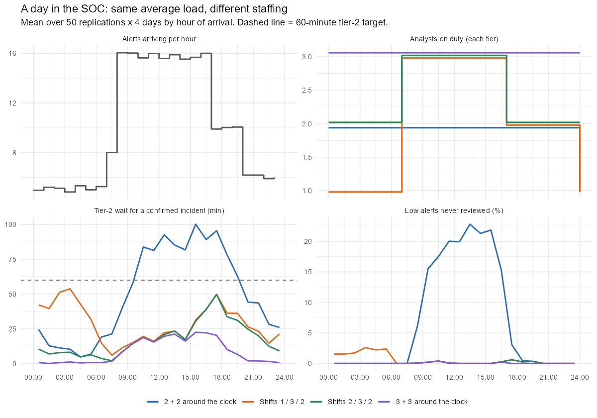
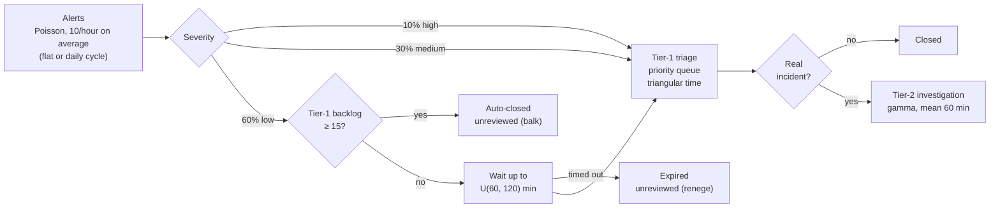
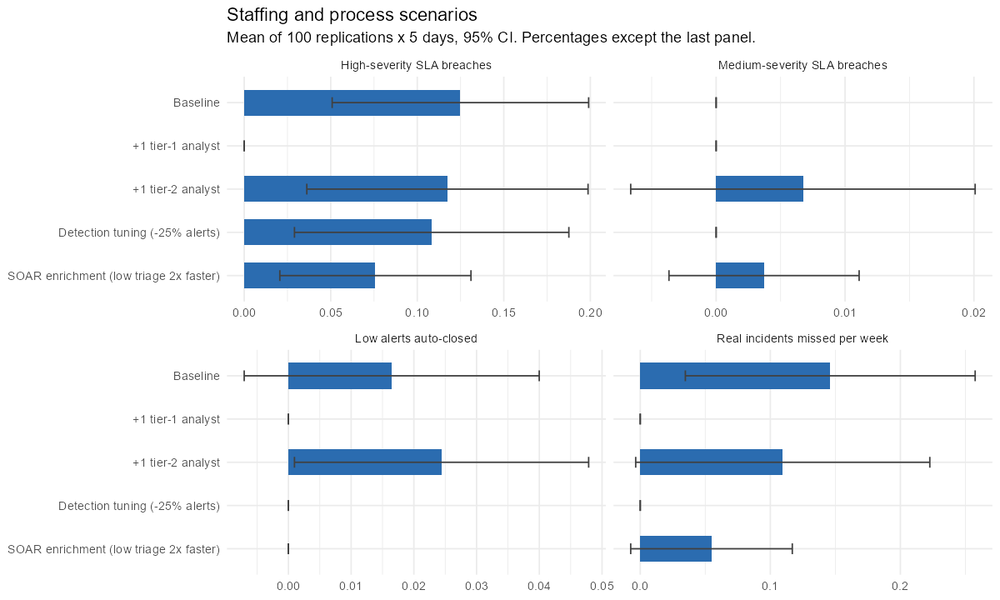
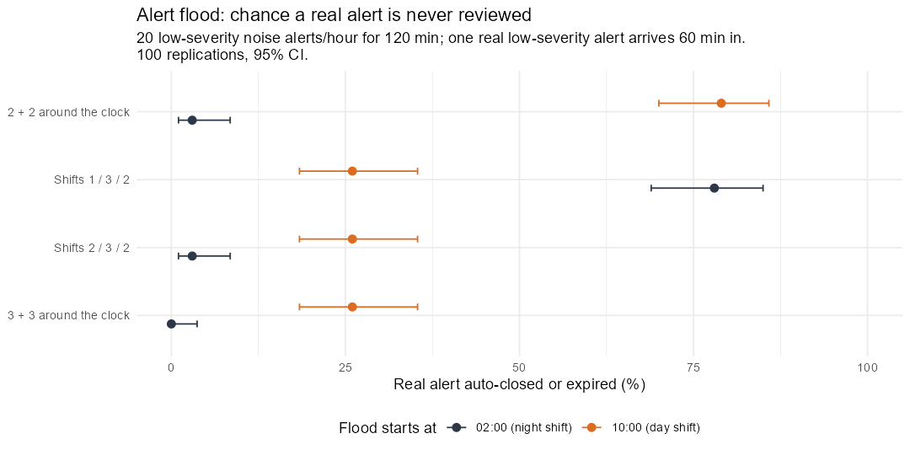
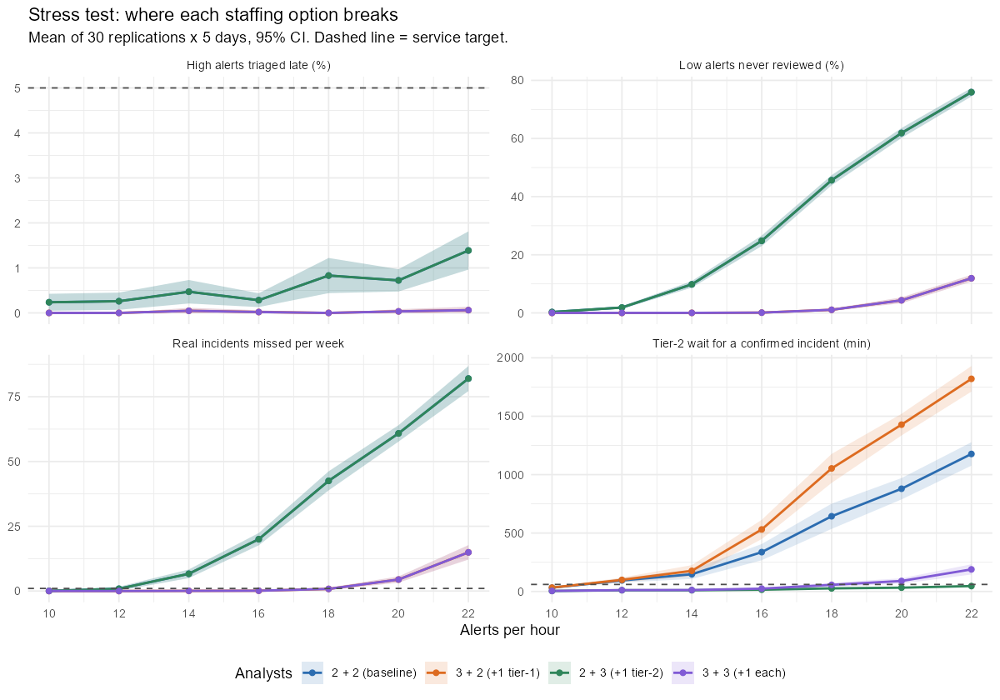

# SOC Alert Triage Simulation

**Discrete-event simulation of a two-tier Security Operations Center in R (`simmer`): how many analysts does it take to meet triage SLAs, when should they be on shift, and what does alert overload actually cost in missed incidents?**

[](https://github.com/casildata/soc-alert-triage-simulation/actions/workflows/pipeline.yml)

-informational)


> **Origin:** built on discrete-event simulation methods from my graduate work in **Simulation & Optimization** at Texas Tech University (2022): queues with priorities, balking and reneging. The original models covered call centers and a clinic; this repository models alert triage.

---

## TL;DR

- **Tier-2 is the bottleneck.** At a steady 10 alerts/hour, one more tier-2 analyst cuts a confirmed incident's wait for an investigator from **34.5 to 4.4 minutes**. Detection tuning and SOAR enrichment don't help tier-2; they make it very slightly worse, because fewer real incidents are dropped before they get there.
- **Staff for the peak, not the average.** With the same average load but a realistic daily cycle (5 alerts/hour at night, 16 in business hours), the 2 + 2 team that coped with a flat load misses **4.5 real incidents a week**. Moving the same people into shifts (1 at night, 3 by day, 2 in the evening, 6% more analyst-hours) meets every target.
- **An attacker can use the gap.** If 2 hours of alert noise start at 02:00, the real alert hidden in it is **never reviewed 78% of the time** when one analyst covers nights, against 3% with two. A flood in the daytime peak buries it 26% of the time even with three analysts.
- **Fixing one tier exposes the other.** In a stress test from 10 to 22 alerts/hour, +1 tier-2 breaks at 14/hour (tier-1 drops alerts and misses 6.7 real incidents a week). **One more analyst in each tier holds to 18/hour** (16 at 95% confidence).
- **Priority queuing hides the damage:** fewer than 2% of high-severity alerts are ever late, even at 22/hour. Overload falls on low-severity alerts (up to 76% never reviewed) and the real incidents among them.



*Same average load and almost the same analyst-hours: the 2 + 2 team (blue) falls behind from mid-morning; the 1 / 3 / 2 shift pattern (orange) keeps up by day but has only one analyst at night.*

---

## Approach

### The question

A SOC receives a stream of alerts of mixed severity. Tier-1 analysts triage them; the real incidents go to tier-2 for investigation. When the backlog grows, low-severity alerts get auto-closed or age out unreviewed, and some of those were real. Leadership's options:

| Scenario | Change |
|---|---|
| Baseline | 2 tier-1, 2 tier-2 analysts, 10 alerts/hour |
| +1 tier-1 analyst | 3 tier-1 |
| +1 tier-2 analyst | 3 tier-2 |
| Detection tuning | 25% fewer alerts, false positives only (removed from the same alert stream, so real incidents are unchanged) |
| SOAR enrichment | Low-severity triage twice as fast |
| Shift patterns | 1–3 analysts per tier depending on the time of day, under a daily alert cycle |
| Alert flood | 2 hours of low-severity noise hiding one real low-severity alert, at night or at the daytime peak |

For each: wait to triage by severity (mean and P90), SLA breach rates, share of low alerts auto-closed or expired, **real incidents missed per week**, tier-2 wait, and analyst utilization, with 95% confidence intervals over the replications.

### The model



| Element | Modeling choice |
|---|---|
| Priorities | High > medium > low in both queues (non-preemptive) |
| Ground truth | Each alert's "real incident" flag is drawn on arrival but only revealed at triage, so the model can count real incidents that were auto-closed or expired: the cost of overload |
| Arrivals | Poisson. The daily cycle is a non-homogeneous Poisson process (thinning), with the same 10 alerts/hour average as the flat case |
| Shifts | Night 00:00–07:00, day 07:00–17:00, evening 17:00–24:00 (simmer `schedule()`); the same number of analysts in both tiers |
| Run length | 5 days per replication; day 1 discarded as warm-up. Arrivals stop after day 5 and the queues drain, so every alert's outcome is known and no wait is censored |
| Common random numbers | Every alert's random inputs (arrival time, severity, ground truth, service times, expiry) are drawn before the run from the replication's seed, so replication *i* sees the same alerts under every staffing option. Differences are measured replication by replication |
| What can be missed | Only low-severity alerts are auto-closed or expire, so "real incidents missed" means real incidents among low-severity alerts (5% of them). High and medium alerts can only be late. Low alerts expire within 120 minutes, so their 240-minute SLA is never reached |
| Analysts vs. staff | "2 + 2" means two analysts on duty in each tier. Covering one seat 24/7 takes about 4.2 full-time staff (8,760 hours a year ÷ 2,080 paid hours, before leave and training), so the baseline is about 17 FTE |

All parameters live in [`R/params.R`](R/params.R) and are **illustrative**. Every scenario is checked by `validate_params()` ([`R/validate.R`](R/validate.R)) before it runs.

## Results

### Analytic check (base R)

Before simulating, [`00_queueing_check.R`](scripts/00_queueing_check.R) treats each tier as an M/G/c queue (Erlang C with the Allen-Cunneen correction). It ignores priorities, auto-closing and expiry, so it's a ballpark and a stability check, not the answer:

| Scenario | Tier-1 utilization | Tier-1 mean wait (min) | Tier-2 utilization | Tier-2 mean wait (min) |
|---|---|---|---|---|
| Baseline | 69% | 4.7 | 70% | 36.0 |
| +1 tier-1 analyst | 46% | 0.6 | 70% | 36.0 |
| +1 tier-2 analyst | 69% | 4.7 | 47% | 4.7 |
| Detection tuning | 52% | 1.9 | 70% | 36.0 |
| SOAR enrichment | 54% | 2.0 | 70% | 36.0 |

Already a useful read: **tier-2 is the slower queue** (36 min average wait for a confirmed incident), and only adding a tier-2 analyst fixes it. The simulation adds what the formula can't: severity-specific SLA breaches, auto-closing and expiry under bursts, and missed incidents.

### Scenarios at a steady 10 alerts/hour

100 replications × 5 days per scenario, first day discarded as warm-up. Cells show the mean and 95% CI across replications. Full tables: [`docs/results.md`](docs/results.md).

| Metric | Baseline | +1 tier-1 | +1 tier-2 | Detection tuning | SOAR enrichment |
|---|---|---|---|---|---|
| Wait for tier-2 (min) | 34.5 (30.5–38.5) | 35.2 (31.2–39.2) | **4.4 (3.9–4.9)** | 35.0 (31.0–39.0) | 34.9 (30.9–38.9) |
| P90 wait for tier-2 (min) | 97.0 (85.7–108.2) | 98.7 (87.5–109.9) | **13.6 (11.9–15.3)** | 97.9 (86.5–109.3) | 97.8 (86.5–109.0) |
| Wait to triage, high severity (min) | 1.8 (1.8–1.9) | **0.5 (0.4–0.5)** | 1.8 (1.8–1.9) | 1.1 (1.1–1.2) | 1.1 (1.1–1.2) |
| High alerts missing 15-min SLA | 0.1% (0.0–0.2) | 0.0% (0.0–0.0) | 0.1% (0.0–0.2) | 0.0% (0.0–0.1) | 0.1% (0.0–0.2) |
| Low alerts expired unreviewed | 0.2% (0.1–0.3) | 0.0% (0.0–0.0) | 0.2% (0.1–0.3) | 0.0% (0.0–0.0) | 0.1% (0.0–0.1) |
| Real incidents missed / week | 0.1 (0.0–0.2) | 0.0 (0.0–0.0) | 0.1 (0.0–0.2) | 0.0 (0.0–0.0) | 0.0 (0.0–0.1) |
| Tier-1 utilization | 69.6% | 46.5% | 69.6% | 52.2% | 53.9% |
| Tier-2 utilization | 69.8% | 69.8% | 46.5% | 69.8% | 69.8% |

Because every scenario sees the same alerts, the change against the baseline can be measured replication by replication (paired 95% CI). For the small effects, the paired interval is about 20 times narrower than comparing the columns above, which is what makes them visible at all:

| Scenario | Change in tier-2 wait vs. baseline (min) |
|---|---|
| +1 tier-1 analyst | +0.69 (+0.38 to +0.99) |
| +1 tier-2 analyst | −30.11 (−33.70 to −26.52) |
| Detection tuning | +0.46 (+0.17 to +0.75) |
| SOAR enrichment | +0.39 (+0.16 to +0.62) |



- **Tier-2 is the bottleneck.** A confirmed incident waits about 35 minutes for an investigator (1 in 10 waits over an hour and a half) unless tier-2 gets another analyst.
- **Helping tier-1 slightly hurts tier-2.** An extra tier-1 analyst, detection tuning and SOAR all lengthen the tier-2 wait by under a minute, a small effect but clearly not zero: tier-1 drops fewer low-severity alerts, so a few more real incidents reach tier-2.
- **Tier-1 already meets its SLAs.** An extra tier-1 analyst cuts high-severity triage from 1.8 to 0.5 minutes, but high-severity SLA breaches are already about 0.1%.
- **A flat load is too light to show overload.** At baseline, 136 of 57,639 low-severity alerts (0.2%) were auto-closed or expired. The cost shows up at higher rates (stress test) and at the daily peak (next section).

### A day in the SOC: daily cycle, shifts and an alert flood

Same average load (10 alerts/hour), but 5/hour at night and 16/hour from 07:00 to 17:00. Four staffing patterns, the same number of analysts in each tier (50 replications × 5 days; the figure is at the top of this page):

| Analysts per tier (night / day / evening) | Analyst-hours per day | ≈ FTE | Tier-2 wait, min (P90) | Worst hour | Low alerts never reviewed | Real incidents missed / week | Meets all targets |
|---|---|---|---|---|---|---|---|
| 2 / 2 / 2 (around the clock) | 96 | 17 | 61 (187) | 100 at 15:00 | 10.6% | 4.5 | no |
| 1 / 3 / 2 | 102 | 18 | 26 (73) | 54 at 03:00 | 0.4% | 0.2 | yes |
| 2 / 3 / 2 | 116 | 20 | 20 (56) | 50 at 17:00 | 0.1% | 0.1 | yes |
| 3 / 3 / 3 (around the clock) | 144 | 25 | 12 (39) | 22 at 15:00 | 0.1% | 0.0 | yes |

Targets are the stress test's: at most 5% of high-severity alerts late, at most 1 real incident missed a week, and a tier-2 wait of at most 60 minutes, all on the mean.

**Alert flood.** On day 2, 20 extra low-severity false positives an hour arrive for 2 hours, and one real low-severity alert (the intrusion the noise is meant to hide) arrives an hour in. Share of 100 replications in which the real alert is never reviewed (Wilson 95% CI):

| Analysts per tier (night / day / evening) | Flood at 02:00 | Same alert, no flood | Flood at 10:00 | Same alert, no flood |
|---|---|---|---|---|
| 2 / 2 / 2 | 3% (1–8) | 0% | 79% (70–86) | 29% |
| 1 / 3 / 2 | **78% (69–85)** | 1% | 26% (18–35) | 0% |
| 2 / 3 / 2 | 3% (1–8) | 0% | 26% (18–35) | 0% |
| 3 / 3 / 3 | 0% (0–4) | 0% | 26% (18–35) | 0% |



- **Peaks break a team that copes on average.** 2 / 2 / 2 handles a flat 10 alerts/hour (0.1 missed incidents a week) but not the same 10 on average with a 16/hour business day: 4.5 missed a week, and the tier-2 wait passes an hour from 09:00 to 19:00.
- **Shifts fix it for 6% more analyst-hours.** 1 / 3 / 2 meets every target with 102 analyst-hours a day against 96, where adding a third analyst around the clock costs 144.
- **But one analyst on nights is a single point of failure.** Averages look fine (the worst tier-2 hour is 54 minutes at 03:00), yet a night-time flood buries the real alert 78% of the time. A second night analyst (2 / 3 / 2, 14 more analyst-hours a day) brings that to 3%. Averages and SLA targets don't show this; a scenario with an adversary does.
- **Noise at the peak works even against a full team.** At 10:00 the day shift is already busy, and the flood fills the tier-1 backlog past the auto-close threshold: the real alert is lost 26% of the time with three analysts, and 79% with two (29% even without the flood).

### Stress test

The alert rate is swept from 10 to 22 per hour (flat) for four staffing options, with everything else at baseline values (30 replications × 5 days per point). An option "breaks" at the first rate where more than 5% of high-severity alerts are triaged late, more than 1 real incident a week is missed, or a confirmed incident waits more than 60 minutes for tier-2. "At 95% confidence" requires the upper end of each CI to meet every target. All settings are in `STRESS` in [`R/params.R`](R/params.R).

| Analysts (tier-1 + tier-2) | Capacity, alerts/hour (tier-1 / tier-2) | Holds up to (mean) | At 95% confidence | Breaks at | Target missed there |
|---|---|---|---|---|---|
| 2 + 2 (baseline) | 14.4 / 14.3 | 10 | 10 | 12 | Tier-2 wait (94 min) |
| 3 + 2 (+1 tier-1) | 21.6 / 14.3 | 10 | 10 | 12 | Tier-2 wait (99 min) |
| 2 + 3 (+1 tier-2) | 14.4 / 21.4 | 12 | 10 | 14 | Missed incidents (6.7/week) |
| 3 + 3 (+1 each) | 21.6 / 21.4 | **18** | 16 | 20 | Tier-2 wait (90 min) and missed incidents (4.4/week) |

"Capacity" is the alert rate at which a tier would be 100% busy if no alert were dropped: 7.2 alerts/hour per tier-1 analyst (8.3 minutes of triage per alert on average) and 7.1 per tier-2 analyst (14% of alerts are real incidents, 60 minutes each).



- **Fixing one tier exposes the other.** An extra tier-1 analyst buys nothing on its own: tier-2 still breaks at 12 alerts/hour. An extra tier-2 analyst buys one step, to 12/hour; then tier-1 starts auto-closing low-severity alerts and real incidents go with them.
- **A faster tier-1 makes tier-2 worse.** At 14 alerts/hour a confirmed incident waits 177 minutes for tier-2 with 3 + 2 analysts, against 147 with 2 + 2: the extra tier-1 analyst drops fewer alerts, so more real incidents reach tier-2. The reverse also holds: the 2 + 3 team's tier-2 wait stays under target up to 22 alerts/hour (46 minutes) partly because tier-1 is auto-closing 76% of low-severity alerts, and the real incidents among them never reach tier-2. A good tier-2 number can be bought by missing incidents upstream.
- **Each option breaks well below its capacity.** Waits climb steeply as utilization approaches 100%, so the 2 + 2 team breaks at about 84% of tier-2 capacity.
- **Priority queuing protects high-severity alerts.** Under every option, fewer than 2% of high-severity alerts are triaged late, even at 22/hour. Overload shows up instead as unreviewed low-severity alerts (up to 76%) and missed incidents (up to 82 a week).
- **Breaking points are approximate at the edges.** The CIs at the boundary straddle the targets (3 + 3 at 18/hour waits 57 minutes, CI 38–75), which is why the 95% column is lower. Past tier-2 capacity the queue grows without limit, so waits there depend on the 5-day run length.

Per-rate tables for every metric: [`docs/results.md`](docs/results.md#3-stress-test).

## Framework mapping

What the model covers, mapped to [NIST CSF 2.0](https://www.nist.gov/cyberframework) outcomes and [CIS Controls v8.1](https://www.cisecurity.org/controls) safeguards. A mapping of what's modeled, not a compliance claim.

| NIST CSF 2.0 | Outcome | In this repository |
|---|---|---|
| GV.RR-03 | Adequate resources are allocated commensurate with the cybersecurity risk strategy, roles, responsibilities, and policies | Staffing scenarios, shift patterns, stress test |
| DE.AE-02 | Potentially adverse events are analyzed to better understand associated activities | Tier-1 triage |
| DE.AE-08 | Incidents are declared when adverse events meet the defined incident criteria | Ground truth revealed at triage |
| RS.MA-02 | Incident reports are triaged and validated | Triage SLAs |
| RS.MA-03 | Incidents are categorized and prioritized | Severity mix and priority queues |
| RS.MA-04 | Incidents are escalated or elevated as needed | Tier-1 → tier-2 escalation and wait |

| CIS v8.1 | Safeguard | In this repository |
|---|---|---|
| 13.11 | Tune Security Event Alerting Thresholds | Detection tuning scenario |
| 17.1 | Designate Personnel to Manage Incident Handling | Tier-2 staffing and shift coverage |
| 17.4 | Establish and Maintain an Incident Response Process | Two-tier triage and escalation |
| 17.9 | Establish and Maintain Security Incident Thresholds | Auto-close backlog threshold and expiry rules |

## Limitations & lessons learned

- **Illustrative inputs.** Rates, triage times and the daily profile are assumptions, not measurements from a real SOC. The results are about mechanisms (bottlenecks, peaks, single points of failure), not headcounts for any particular team.
- **Analysts are interchangeable and tireless.** No breaks, handovers, fatigue or skill differences; a shift change happens instantly.
- **Breaking points and "meets all targets" use the mean**, except where marked 95%.

### Verification status

| Component | Status |
|---|---|
| Unit tests (`tests/testthat/`) | 48 expectations pass: metrics on hand-built monitor tables (outcomes, censored SLA breaches, missed incidents, measurement window, utilization with shifts and drain, CIs); parameter validation; and short simulations checking that queues drain, only low-severity alerts are dropped, staffing doesn't change which alerts arrive, tuning removes false positives only, shift schedules set capacity, and a flood plants exactly one real alert |
| Analytic check | All scenarios stable (utilization < 1) |
| Simulation vs. analytic check | Utilization 69.6% / 69.8% vs. 69% / 70%; tier-2 wait 34.5 min (CI 30.5–38.5) vs. 36.0. Tier-1 wait 5.4 min vs. 4.7: priority goes to high-severity alerts, which take the longest to triage (13 minutes vs. 6 for low), and serving long jobs first raises the average wait. With priorities switched off the simulation gives 4.9 minutes, matching the formula (both in [`docs/results.md`](docs/results.md)) |
| Common random numbers | 2 + 2 and 2 + 3 produce identical tier-1 results at every stress-test rate, as they should (tier-1 doesn't depend on tier-2 staffing) |
| CI ([`.github/workflows/pipeline.yml`](.github/workflows/pipeline.yml)) | On every push: tests, the full pipeline, and a check that `docs/results.md` is reproduced exactly; tests on R 4.1; secret scan (gitleaks) |

Improvements over the original 2022 version are documented in [CHANGELOG.md](CHANGELOG.md).

## Getting started

### Requirements

- R 4.1 or later (tested on 4.6.1) with `simmer` and `ggplot2`; `testthat` for the tests.
- No external data: all parameters are in [`R/params.R`](R/params.R) and are illustrative.

### Install

The exact versions used for the results are pinned in [`renv.lock`](renv.lock):

```r
install.packages("renv")
renv::restore()
```

Or the current CRAN versions: `install.packages(c("simmer", "ggplot2", "testthat"))`. Nothing is installed automatically: if a package is missing, the scripts stop and print the command.

### Run

```bash
Rscript -e 'testthat::test_dir("tests/testthat")'   # about 10 seconds
Rscript run_all.R                                   # analytic check, simulations, report
```

### Output

About 6 minutes. `run_all.R` writes every table and figure to `docs/results.md`; per-replication and per-scenario tables go to `outputs/` (git-ignored).

## Repository structure

```
soc-alert-triage-simulation/
├── run_all.R                    # analytic check, simulations, report
├── renv.lock                    # pinned package versions
├── r-packages.txt               # R packages used
├── R/
│   ├── check_packages.R         # stops with install instructions if a package is missing
│   ├── params.R                 # all parameters: scenarios, stress test, daily cycle and flood
│   ├── validate.R               # parameter checks run before every simulation
│   ├── model.R                  # alert draws (common random numbers) and simmer trajectories
│   ├── metrics.R                # monitor tables → per-alert outcomes → metrics + CIs
│   └── report.R                 # markdown report helpers
├── scripts/
│   ├── 00_queueing_check.R      # Erlang C / Allen-Cunneen (base R)
│   ├── 01_simulate.R            # 5 scenarios x 100 replications
│   ├── 02_analyze.R             # tables, paired differences, priority check, figures
│   ├── 03_stress_test.R         # alert-rate sweep x 4 staffing options
│   └── 04_daily_cycle.R         # daily cycle, shift patterns, alert flood
├── tests/testthat/              # metrics, validation and model tests
├── .github/workflows/           # CI: tests, pipeline, results check, R 4.1, gitleaks
└── docs/results.md              # generated
```

## Skills demonstrated

`Discrete-event simulation (priority queues, balking, reneging, shift schedules, warm-up, queue drain)` · `non-homogeneous Poisson arrivals (thinning)` · `common random numbers and paired comparisons` · `queueing theory as a sanity check (Erlang C, Allen-Cunneen)` · `adversarial scenario design (alert flood)` · `SOC operations metrics (SLA, P90 waits, alert fatigue, escalation, FTE)` · `testable analysis code, CI, renv` · `R (simmer, ggplot2, testthat)`

## Roadmap

- Optimize staffing: the cheapest shift rota that meets every target at 95% confidence, by analyst cost per tier.
- Calibrate from real data: fit the hourly profile, severity mix and triage times from a SIEM or ticketing export.
- Preemption (a critical alert interrupts a low-severity triage) and analyst fatigue as sensitivity checks.
- A small Shiny app to try staffing patterns interactively.

## Author

Javier Casildo

## License

MIT. See [LICENSE](LICENSE).
