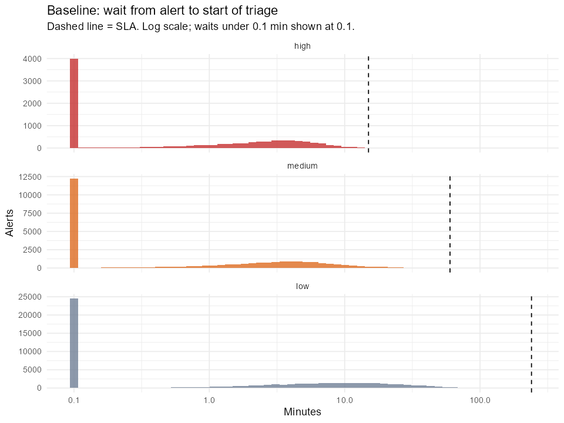
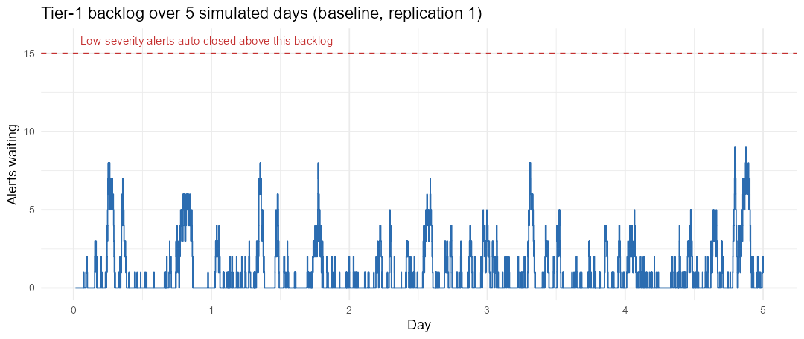

# Results

Generated by `Rscript run_all.R`. Parameters are **illustrative** (see `R/params.R`).

## 0. Analytic check (M/G/c, Allen-Cunneen)

Ignores priorities, auto-closing and expiry. Waits are in minutes.

| scenario | tier1_utilization | tier1_mean_wait_min | tier2_utilization | tier2_mean_wait_min | incidents_per_day |
|---|---|---|---|---|---|
| Baseline | 0.69 | 4.69 | 0.70 | 36.03 | 33.60 |
| +1 tier-1 analyst | 0.46 | 0.62 | 0.70 | 36.03 | 33.60 |
| +1 tier-2 analyst | 0.69 | 4.69 | 0.47 | 4.74 | 33.60 |
| Detection tuning (-25% alerts) | 0.52 | 1.87 | 0.70 | 36.03 | 33.60 |
| SOAR enrichment (low triage 2x faster) | 0.54 | 2.00 | 0.70 | 36.03 | 33.60 |

## 1. Scenario comparison

100 replications x 5 days per scenario (first day discarded as warm-up). Cells: mean (95% CI across replications).

| metric | Baseline | +1 tier-1 analyst | +1 tier-2 analyst | Detection tuning (-25% alerts) | SOAR enrichment (low triage 2x faster) |
|---|---|---|---|---|---|
| Mean wait to triage, high (min) | 1.8 (1.8–1.9) | 0.4 (0.4–0.5) | 1.8 (1.7–1.8) | 1.1 (1.1–1.2) | 1.1 (1.0–1.1) |
| High alerts missing 15-min SLA | 0.1% (0.1–0.2) | 0.0% (0.0–0.0) | 0.1% (0.0–0.2) | 0.1% (0.0–0.2) | 0.1% (0.0–0.1) |
| Medium alerts missing 60-min SLA | 0.0% (0.0–0.0) | 0.0% (0.0–0.0) | 0.0% (-0.0–0.0) | 0.0% (0.0–0.0) | 0.0% (-0.0–0.0) |
| Low alerts auto-closed (backlog) | 0.0% (-0.0–0.0) | 0.0% (0.0–0.0) | 0.0% (0.0–0.0) | 0.0% (0.0–0.0) | 0.0% (0.0–0.0) |
| Low alerts expired unreviewed | 0.2% (0.1–0.3) | 0.0% (0.0–0.0) | 0.2% (0.1–0.3) | 0.0% (-0.0–0.0) | 0.1% (0.0–0.1) |
| Real incidents missed / week | 0.1 (0.0–0.3) | 0.0 (0.0–0.0) | 0.1 (-0.0–0.2) | 0.0 (0.0–0.0) | 0.1 (-0.0–0.1) |
| Wait for tier-2 (min) | 33.9 (30.6–37.3) | 35.5 (32.1–38.8) | 4.4 (3.9–5.0) | 34.8 (31.3–38.3) | 33.8 (30.1–37.5) |
| Tier-1 utilization | 69.4% (69.0–69.8) | 46.4% (46.2–46.7) | 69.3% (68.9–69.7) | 51.5% (51.1–51.9) | 53.4% (53.0–53.8) |
| Tier-2 utilization | 69.8% (68.7–71.0) | 69.9% (68.6–71.2) | 46.5% (45.7–47.4) | 68.9% (67.7–70.0) | 69.2% (68.1–70.4) |

## 2. Baseline detail

Alert outcomes in the measurement window (all replications):

| severity | auto-closed (backlog) | expired unreviewed | triaged |
|---|---|---|---|
| high | 0 | 0 | 9,124 |
| medium | 0 | 0 | 27,585 |
| low | 9 | 104 | 55,774 |

## 3. Stress test

Alert rate swept from 10 to 22 per hour for four staffing options (30 replications x 5 days per point). Everything else stays at the baseline values. Targets: at most 5% of high-severity alerts triaged late, at most 1 real incident missed per week, and a tier-2 wait of at most 60 min.

Capacity if no alert were dropped: each tier-1 analyst triages 7.2 alerts/hour (8.3 min per alert on average); each tier-2 analyst keeps up with 7.1 alerts/hour (14% of alerts are real incidents, 60 min each). Past tier-2 capacity its queue grows without limit, so the waits reported there depend on run length.

### Breaking points

| staffing (tier-1 + tier-2) | capacity, alerts/hour (tier-1 / tier-2) | highest rate meeting all targets | first rate that fails | targets missed there |
|---|---|---|---|---|
| 2 + 2 (baseline) | 14.4 / 14.3 | 10 | 12 | > 1 real incident missed / week; tier-2 wait > 60 min |
| 3 + 2 (+1 tier-1) | 21.6 / 14.3 | 10 | 12 | tier-2 wait > 60 min |
| 2 + 3 (+1 tier-2) | 14.4 / 21.4 | 12 | 14 | > 1 real incident missed / week |
| 3 + 3 (+1 each) | 21.6 / 21.4 | 18 | 20 | > 1 real incident missed / week; tier-2 wait > 60 min |

### Real incidents missed per week

| staffing | 10 | 12 | 14 | 16 | 18 | 20 | 22 |
|---|---|---|---|---|---|---|---|
| 2 + 2 (baseline) | 0.2 | 1.0 | 5.7 | 21.4 | 39.7 | 59.7 | 81.3 |
| 3 + 2 (+1 tier-1) | 0.0 | 0.0 | 0.0 | 0.0 | 0.7 | 4.5 | 14.7 |
| 2 + 3 (+1 tier-2) | 0.2 | 0.9 | 7.5 | 20.1 | 39.3 | 61.3 | 85.5 |
| 3 + 3 (+1 each) | 0.0 | 0.0 | 0.0 | 0.2 | 0.5 | 4.1 | 12.2 |

### Tier-2 wait for a confirmed incident (min)

| staffing | 10 | 12 | 14 | 16 | 18 | 20 | 22 |
|---|---|---|---|---|---|---|---|
| 2 + 2 (baseline) | 33.6 | 70.1 | 161.2 | 243.0 | 284.2 | 489.2 | 703.5 |
| 3 + 2 (+1 tier-1) | 37.0 | 100.2 | 179.0 | 275.6 | 292.4 | 441.3 | 703.9 |
| 2 + 3 (+1 tier-2) | 4.8 | 8.3 | 13.3 | 17.3 | 22.4 | 38.1 | 55.9 |
| 3 + 3 (+1 each) | 5.5 | 8.5 | 15.9 | 24.3 | 51.2 | 97.6 | 183.1 |

### High-severity alerts triaged late

| staffing | 10 | 12 | 14 | 16 | 18 | 20 | 22 |
|---|---|---|---|---|---|---|---|
| 2 + 2 (baseline) | 0.0% | 0.4% | 0.2% | 0.6% | 0.9% | 1.6% | 1.5% |
| 3 + 2 (+1 tier-1) | 0.0% | 0.0% | 0.0% | 0.0% | 0.0% | 0.0% | 0.0% |
| 2 + 3 (+1 tier-2) | 0.1% | 0.4% | 0.4% | 0.7% | 0.8% | 0.9% | 1.1% |
| 3 + 3 (+1 each) | 0.0% | 0.0% | 0.0% | 0.0% | 0.0% | 0.0% | 0.0% |

### Low-severity alerts never reviewed (auto-closed or expired)

| staffing | 10 | 12 | 14 | 16 | 18 | 20 | 22 |
|---|---|---|---|---|---|---|---|
| 2 + 2 (baseline) | 0.2% | 1.8% | 8.8% | 25.8% | 44.9% | 62.2% | 75.7% |
| 3 + 2 (+1 tier-1) | 0.0% | 0.0% | 0.0% | 0.1% | 1.0% | 4.0% | 12.6% |
| 2 + 3 (+1 tier-2) | 0.2% | 1.7% | 9.7% | 25.9% | 44.6% | 62.1% | 75.4% |
| 3 + 3 (+1 each) | 0.0% | 0.0% | 0.0% | 0.2% | 0.9% | 4.3% | 11.8% |

